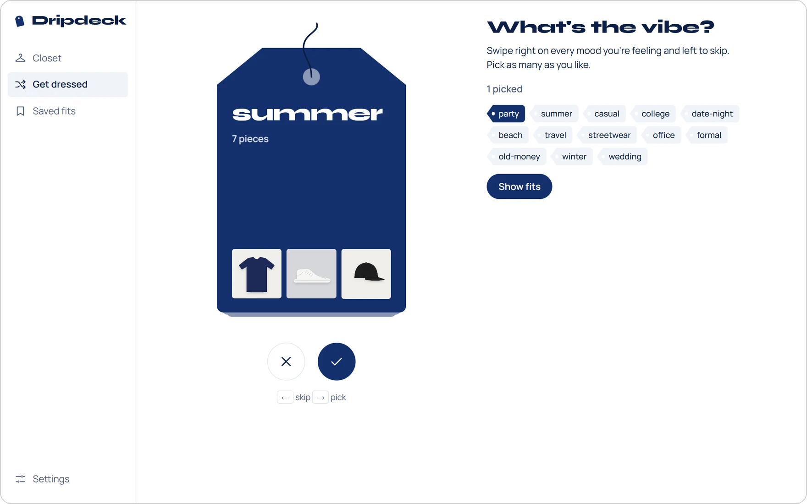
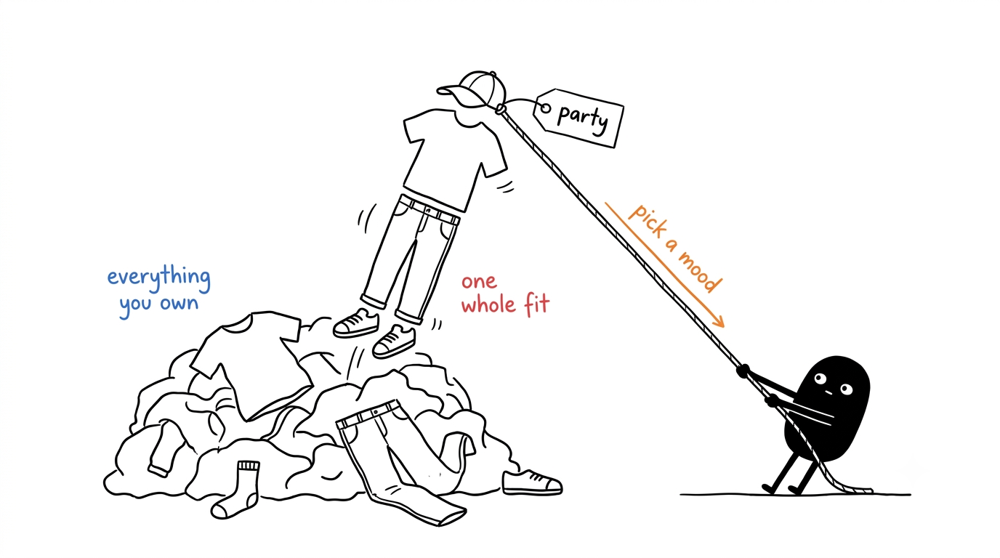
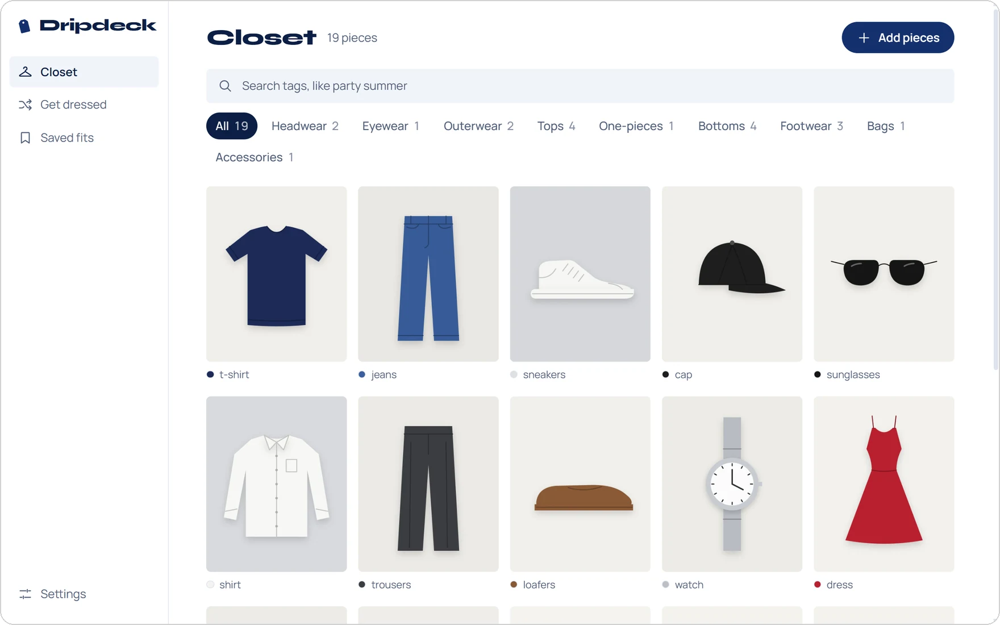
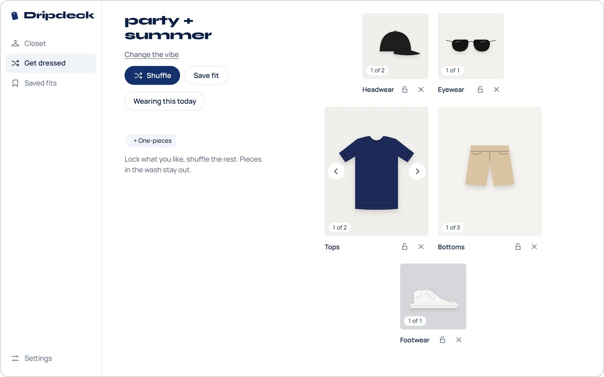
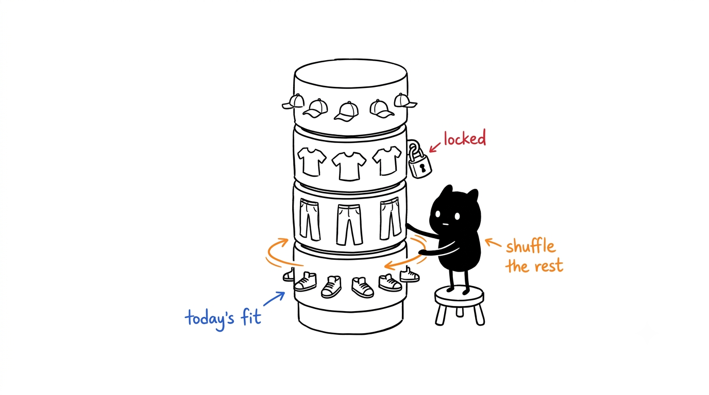
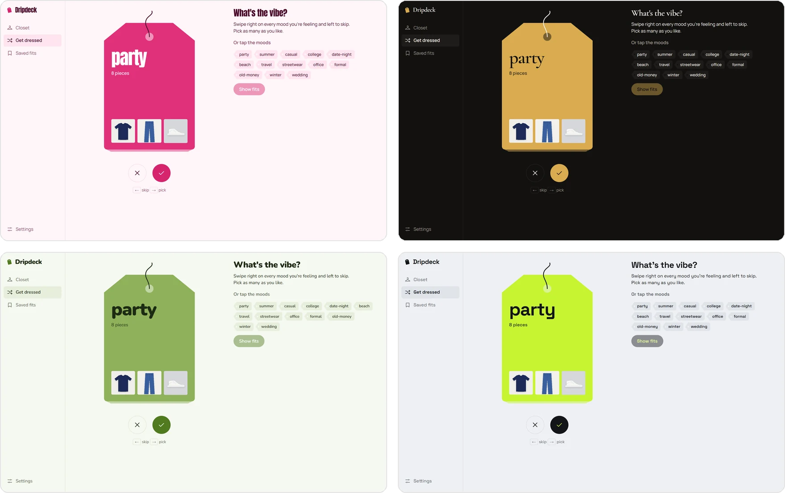
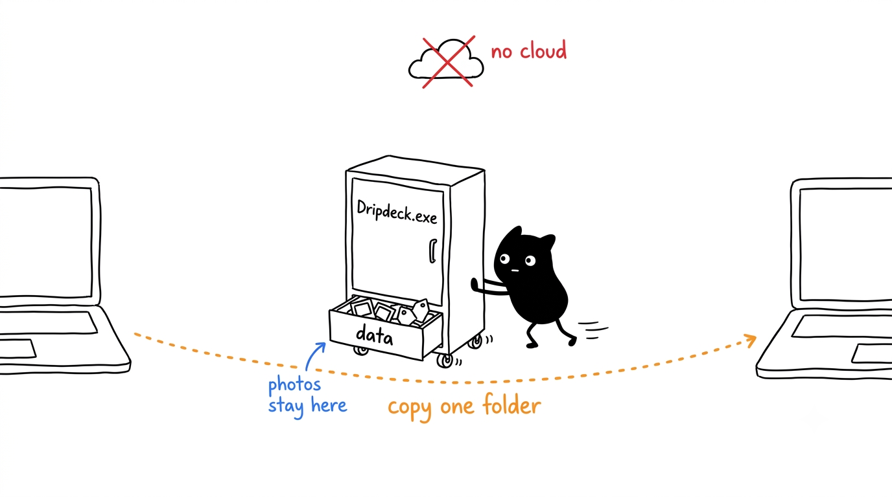
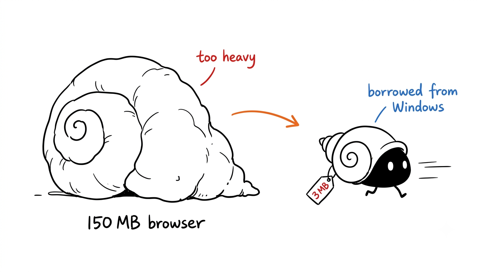
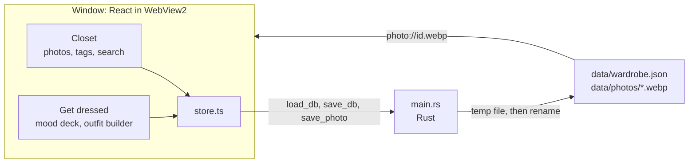

<div align="center">

# Dripdeck

Pick outfits from the clothes you already own, one mood at a time.<br>
A free, open-source wardrobe app for Windows. Your photos never leave your PC.

[![Tauri 2][badge-tauri]][link-tauri]
[![Rust][badge-rust]][link-rust]
[![React][badge-react]][link-react]
[![TypeScript][badge-ts]][link-ts]
[![Windows 10 | 11][badge-windows]][link-windows]
[![License: MIT][badge-license]](LICENSE)

**[Download for Windows][link-release]**



</div>

<p align="center"></p>

## About

If you own a lot of clothes, getting dressed takes longer than it should. You forget half of what's in the wardrobe, you reach for the same five pieces, and working out what goes with what is a small job of its own every morning.

Dripdeck turns your wardrobe into something you can search and shuffle. You photograph each piece once and tag it the way you think about it: what it is (t-shirt, jeans), where you'd wear it (party, office, beach) and when (summer, winter). When you're getting ready, your moods come up as cards. Swipe right on the ones you're feeling, and Dripdeck lays out a whole outfit, head to toe, from the pieces that match. Don't like it? Shuffle. Love the top? Lock it and shuffle the rest.

It's a small Windows app, about 3.4 MB, that keeps everything in a folder next to it. There's no account, no cloud and nothing to sign in to.

## How it works

| You do this | You get |
|---|---|
| Drop, paste or pick photos of your clothes | Each photo shrunk to a small WebP, with its main colours already tagged |
| Pick a category and add tags | The piece filed under Tops, Bottoms, Footwear… and findable by any of its tags |
| Search `party summer` | Every piece tagged with both |
| Swipe a mood card right, or press **→** | That mood is picked |
| Swipe it left, or press **←** | The card goes to the back of the deck |
| Press **Show fits** | A whole outfit from the pieces that match your moods |
| Press **Shuffle** | A new outfit. Anything you locked stays put |
| Press **Wearing this today** | The fit is saved, and each piece's wear count goes up |

### The closet



Every piece gets one category: **Headwear, Eyewear, Outerwear, Tops, One-pieces, Bottoms, Footwear, Bags, Accessories** or **Other**. Add photos by dropping them on the window, pasting one with **Ctrl+V**, or picking files. Dripdeck shrinks each photo to at most 1000 px on its longest side and reads its main colours, so a navy tee comes in already tagged `navy`.

Tags work like GitHub topics: lowercase words joined by hyphens, so typing "Party Wear" gives you `party-wear`. Search with several words and you get the pieces that have all of them; `party sum` is enough to find party + summer. Click a tag on any piece to see everything else that has it.

Dripdeck ships with these tags, and any tag you type becomes one of yours:

| Group | Examples | Shows up as a mood card |
|---|---|---|
| Types | t-shirt, shirt, hoodie, kurta, jeans, chinos, skirt, dress, sneakers, loafers, cap, sunglasses, watch | No |
| Occasions | casual, college, office, formal, party, date-night, wedding, festive, gym, beach, travel, lounge | Yes |
| Seasons | summer, winter, monsoon, all-season | Yes |
| Styles | streetwear, minimal, old-money, y2k, ethnic, sporty, vintage | Yes |
| Colours | black, white, grey, beige, brown, red, maroon, pink, olive, green, blue, light-blue, navy… | No |
| Yours | anything you type | Yes |

Mark a piece **In the wash** and it stays out of every outfit until you mark it clean. When the laundry's done, one click marks everything clean again.

### Getting dressed



Your mood tags are dealt as a deck of swing tags, most used first. Pick as many as you like, by swiping or by tapping the moods next to the deck, then press **Show fits**.

The outfit builder fills one slot per category, laid out head to toe, and only uses pieces that share at least one of your moods. Pieces that match more of your moods come first, and pieces you haven't worn in a while come up more often: each extra mood a piece matches doubles its chances, and a piece you haven't worn for a month is four times as likely as one you wore today.



- Hover a slot and use its arrows to step through its pieces, the lock to keep one, and the cross to leave a category out.
- A dress or jumpsuit replaces the top and the bottom, so **One-pieces** starts switched off whenever you have tops or bottoms that match.
- **Save fit** keeps the combination. **Wearing this today** saves it too and counts a wear for each piece, once per day.
- Saved fits keep their moods and wear history, and you can wear one again from there.

## Themes and fonts



Pick a theme and a font pair under **Settings**. Any theme works with any font, and every font is bundled, so nothing is downloaded.

| Theme | Colours |
|---|---|
| **Old Money** (default) | Navy and white |
| **Barbiecore** | Hot pink and blush |
| **Clean Girl** | Greige and espresso |
| **Matcha** | Matcha green and milk |
| **Y2K** | Silver and lime |
| **Coastal** | Sea glass and teal |
| **Mob Wife** | Black and gold |
| **Goth** | Black and blood red |

| Font pair | Faces |
|---|---|
| **Editorial** (default) | Syne and Manrope |
| **Loud** | Anton and Manrope |
| **Soft** | Nunito |
| **Luxe** | Cormorant Garamond and Manrope |
| **Clean** | Outfit |
| **Techy** | Space Grotesk |

Make the window narrower than 720 px and Dripdeck switches to its phone layout, with a tab bar along the bottom.

## Getting started

### Requirements

Windows 11 or Windows 10, on x64. Both already include WebView2, which draws the app's window.

### Download

Download `Dripdeck.exe` from the [latest release][link-release] and put it in a folder of its own, such as `Documents\Dripdeck`. Your wardrobe is saved in a `data` folder next to the exe, so a folder of its own keeps the two together.

The exe isn't signed, so the first time you open it Windows SmartScreen may say it protected your PC. Click **More info**, then **Run anyway**.

### Build from source

You need [Node.js](https://nodejs.org) 22 or newer, [Rust](https://rustup.rs), and the [Visual Studio Build Tools](https://visualstudio.microsoft.com/visual-cpp-build-tools/) with the **Desktop development with C++** workload. Then, in PowerShell:

```powershell
git clone https://github.com/RudraSomaiya/DripDeck.git
cd DripDeck
npm install
npm run app
```

`npm run app` builds the release version and copies it to `app\Dripdeck.exe`. The first build downloads and compiles the Rust crates and takes a few minutes. Later builds take about a minute.

### Run

Open `Dripdeck.exe`. You can pin it to Start or the taskbar like any other app. It opens on an empty closet: drop in photos of the clothes you wear most and tag them, then head to **Get dressed**.

The first launch creates a `data` folder next to the exe. That folder is your wardrobe.

### Update and uninstall

To update, close Dripdeck and swap in the new `Dripdeck.exe` from the [latest release][link-release], keeping the `data` folder next to it. If you build from source, run this instead:

```powershell
git pull          # close Dripdeck first
npm install
npm run app       # replaces app\Dripdeck.exe and leaves app\data alone
```

To uninstall, delete the folder that holds `Dripdeck.exe`. Your wardrobe is the `data` folder inside it, so copy that somewhere first if you want to keep it. WebView2 also keeps a small cache, with none of your wardrobe in it, in `%LOCALAPPDATA%\com.rudrasomaiya.dripdeck`, which you can delete too.

## Settings

| Section | What you can change |
|---|---|
| **Theme** | One of eight themes |
| **Font** | One of six font pairs |
| **Mood cards** | Which tags show up as cards in Get dressed, and removing your own tags that no piece uses |
| **Your data** | Shows where the data folder is, with a button that opens it in Explorer |

## Your wardrobe stays on your PC



Dripdeck never sends your photos or tags anywhere:

- **One folder.** Everything lives in the `data` folder next to `Dripdeck.exe`. Copy the exe and the folder together to back up your wardrobe or move it to another PC.
- **No half-written files.** Every save goes to a temporary file first and is renamed over the old one, so a crash or a power cut can't leave a broken wardrobe file. If `wardrobe.json` ever can't be read, Dripdeck stops and says so instead of starting over with an empty closet.
- **Only its own folder.** The app reads and writes inside `data` and nowhere else. Photo names are checked, so a bad name can't reach outside the photos folder.
- **Offline.** Dripdeck makes no network requests. The fonts are bundled and the window's security policy only allows the app's own files. There is no account, no telemetry and no auto-update.

| What | Where |
|---|---|
| Pieces, tags, saved fits and settings | `data\wardrobe.json` |
| Photos, one per piece | `data\photos\<id>.webp` |
| WebView2's cache (no wardrobe data) | `%LOCALAPPDATA%\com.rudrasomaiya.dripdeck` |

## How it's built



Dripdeck is a [Tauri 2](https://tauri.app) app. The screens are React and TypeScript, drawn by the WebView2 runtime that ships with Windows, so the app doesn't carry a browser of its own and the exe stays at about 3.4 MB. A small Rust layer, one file, owns the data folder: it loads and saves `wardrobe.json`, writes photos, and serves them back to the window through a private `photo://` protocol.



Photos are resized and their colours read inside the window, before anything is written to disk. Colour detection compares the middle of the photo with its edges: whatever colour fills the edges is taken as the background, and the piece is what's left in the middle. If the middle is almost all that colour too, like a white tee on a white sheet, the piece is that colour.

The outfit logic, including tags, search, colours, ranking and the wear log, lives in `src/logic.ts` with no browser or Tauri calls, so `npm test` runs it straight in Node.

## Project layout

```
DripDeck/
├── src/
│   ├── logic.ts           Types, built-in tags, colour detection, search, outfit ranking
│   ├── logic.test.ts      Tests for logic.ts (node --test)
│   ├── store.ts           Loads and saves the data folder through the Rust commands
│   ├── App.tsx            The window: navigation, loading and saving
│   ├── Closet.tsx         Photo grid, search, filters, adding and editing pieces
│   ├── Dress.tsx          The mood deck and the outfit builder
│   ├── Fits.tsx           Saved fits and the wear log
│   ├── Settings.tsx       Themes, fonts, mood cards, the data folder
│   ├── ui.tsx             Icons, tag chips, the dialog
│   └── styles.css         Themes, fonts and layout
├── src-tauri/
│   ├── src/main.rs        The data folder: load, save, photos, the photo:// protocol
│   ├── tauri.conf.json    Window, security policy, build settings
│   └── icons/             App icons, made from app-icon.svg
└── docs/images/           Screenshots and illustrations for this README
```

## Development

```powershell
npm run tauri dev            # the app in a window, with live reload
npm run dev                  # just the UI in a browser at http://localhost:1420
npm test                     # tags, search, colours, ranking, wear log
cd src-tauri; cargo test     # photo names can't leave the photos folder
npm run app                  # release build into app\Dripdeck.exe
```

`npm run dev` keeps everything in memory and saves nothing, which makes it handy for working on the UI without touching a real wardrobe. `npm run tauri dev` saves to `src-tauri\target\debug\data`, next to the debug exe.

## Known limitations

- Windows only for now. Tauri can build for macOS, Linux and Android, but Dripdeck hasn't been set up or tested there.
- The exe isn't signed yet, so Windows SmartScreen asks before the first run.
- iPhone HEIC photos can't be read. Export them as JPG or PNG first.
- Colour detection expects a plain background. A busy pattern behind the piece can fool it; colour tags can always be edited.
- One piece per slot, so an outfit has one accessory and one bag.
- Tags can't be renamed or merged yet.

## Credits

Dripdeck stands on [Tauri](https://tauri.app), [React](https://react.dev), [Motion](https://motion.dev) and [Vite](https://vite.dev). The fonts are [Syne](https://fonts.google.com/specimen/Syne), [Manrope](https://fonts.google.com/specimen/Manrope), [Anton](https://fonts.google.com/specimen/Anton), [Nunito](https://fonts.google.com/specimen/Nunito), [Cormorant Garamond](https://fonts.google.com/specimen/Cormorant+Garamond), [Outfit](https://fonts.google.com/specimen/Outfit) and [Space Grotesk](https://fonts.google.com/specimen/Space+Grotesk), all under the SIL Open Font License and bundled through [Fontsource](https://fontsource.org). The mood deck's drag physics come from [Skilldeck](https://github.com/RudraSomaiya/skilldeck). The illustrations were made with the [Ian Xiaohei Illustrations](https://github.com/helloianneo/ian-xiaohei-illustrations) style.

## License

Released under the [MIT License](LICENSE).

## Author

Made by Rudra Somaiya.

[![GitHub][badge-github]][link-github]
[![LinkedIn][badge-linkedin]][link-linkedin]

[badge-tauri]: https://img.shields.io/badge/Tauri-2-24C8D8?style=for-the-badge&logo=tauri&logoColor=white
[badge-rust]: https://img.shields.io/badge/Rust-000000?style=for-the-badge&logo=rust&logoColor=white
[badge-react]: https://img.shields.io/badge/React-149ECA?style=for-the-badge&logo=react&logoColor=white
[badge-ts]: https://img.shields.io/badge/TypeScript-3178C6?style=for-the-badge&logo=typescript&logoColor=white
[badge-windows]: https://img.shields.io/badge/Windows-10_|_11-0078D4?style=for-the-badge&logo=windows11&logoColor=white
[badge-license]: https://img.shields.io/badge/License-MIT-F7DF1E?style=for-the-badge
[badge-github]: https://img.shields.io/badge/GitHub-RudraSomaiya-181717?style=for-the-badge&logo=github&logoColor=white
[badge-linkedin]: https://img.shields.io/badge/LinkedIn-Rudra_Somaiya-0A66C2?style=for-the-badge&logo=data:image/svg%2bxml;base64,PHN2ZyB4bWxucz0iaHR0cDovL3d3dy53My5vcmcvMjAwMC9zdmciIHZpZXdCb3g9IjAgMCAyNCAyNCI+PHBhdGggZmlsbD0iI2ZmZiIgZD0iTTIwLjQ1IDIwLjQ1aC0zLjU2di01LjU3YzAtMS4zMy0uMDItMy4wNC0xLjg1LTMuMDQtMS44NSAwLTIuMTQgMS40NS0yLjE0IDIuOTR2NS42N0g5LjM1VjloMy40MXYxLjU2aC4wNWMuNDgtLjkgMS42NC0xLjg1IDMuMzctMS44NSAzLjYgMCA0LjI3IDIuMzcgNC4yNyA1LjQ2djYuMjh6TTUuMzQgNy40M2EyLjA2IDIuMDYgMCAxIDEgMC00LjEyIDIuMDYgMi4wNiAwIDAgMSAwIDQuMTJ6TTcuMTIgMjAuNDVIMy41NlY5aDMuNTZ2MTEuNDV6TTIyLjIyIDBIMS43N0MuNzkgMCAwIC43NyAwIDEuNzN2MjAuNTRDMCAyMy4yMy43OSAyNCAxLjc3IDI0aDIwLjQ1Yy45OCAwIDEuNzgtLjc3IDEuNzgtMS43M1YxLjczQzI0IC43NyAyMy4yIDAgMjIuMjIgMHoiLz48L3N2Zz4=
[link-release]: https://github.com/RudraSomaiya/DripDeck/releases/latest
[link-tauri]: https://tauri.app
[link-rust]: https://www.rust-lang.org
[link-react]: https://react.dev
[link-ts]: https://www.typescriptlang.org
[link-windows]: https://www.microsoft.com/windows
[link-github]: https://github.com/RudraSomaiya
[link-linkedin]: https://www.linkedin.com/in/rudra-somaiya/
